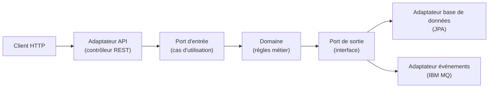
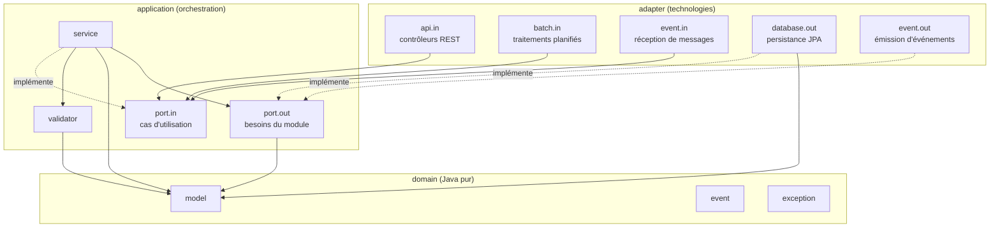
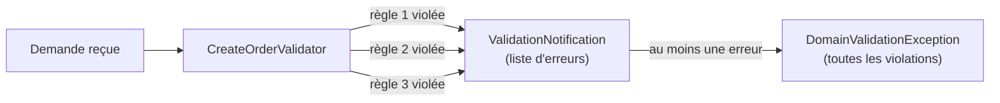
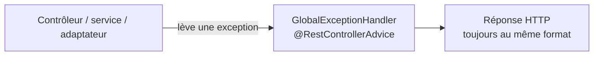
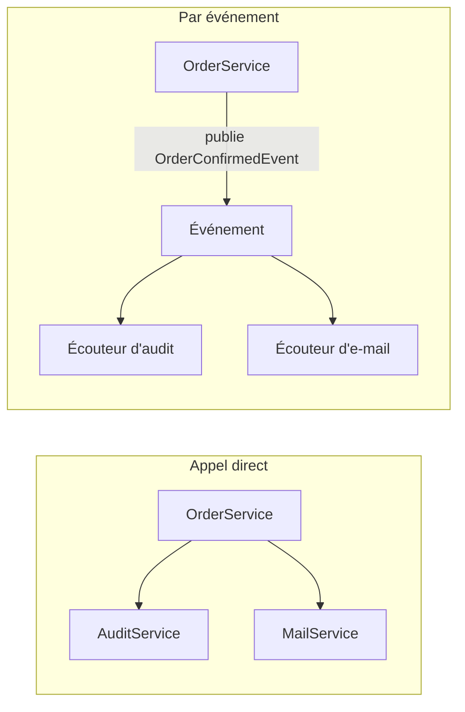
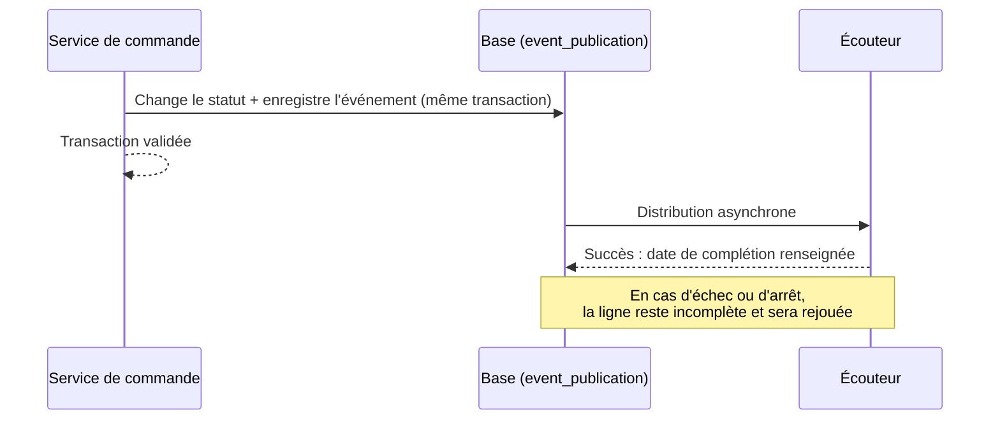

# Order Management : choix d'architecture du backend

> **Public visé** : toutes les équipes de développement, quel que soit leur niveau en Java.
> Chaque section commence par l'idée générale, expliquée simplement et avec un exemple, puis
> détaille la mise en œuvre dans le projet. Un débutant peut lire les introductions et les
> tableaux ; un développeur expérimenté trouvera le détail technique dans le reste de chaque section.
>
> **Périmètre** : le backend uniquement (le frontend n'est pas couvert).
>
> **Convention de lecture** : les éléments marqués **« cible »** décrivent l'organisation que
> les équipes doivent adopter ; ils ne reflètent pas encore tout le code existant. Les éléments
> marqués **« actuel »** décrivent le code tel qu'il est aujourd'hui. Le chapitre 2 explique l'écart.

## Sommaire

1. [Introduction](#1-introduction)
2. [Structure des packages](#2-structure-des-packages)
3. [Validation dans le domaine](#3-validation-dans-le-domaine)
4. [Gestion des erreurs avec `@RestControllerAdvice`](#4-gestion-des-erreurs-avec-restcontrolleradvice)
5. [Spring Modulith](#5-spring-modulith)
6. [Glossaire](#6-glossaire)
7. [Où trouver le détail](#7-où-trouver-le-détail)

---

## 1. Introduction

### 1.1 Le projet en quelques mots

Order Management est une application Java (Spring Boot) qui gère des **commandes**, des
**clients** et des **produits**. Elle expose une API REST, enregistre ses données dans une base
PostgreSQL, échange des messages avec d'autres applications par IBM MQ et exécute un traitement
planifié (Spring Batch) qui fait passer les commandes confirmées à l'état « complétée ».

**Ce projet n'a pas pour but d'être une gestion de commandes complète et fonctionnelle.** Les
commandes, clients et produits ne sont qu'un **prétexte** : un sujet assez simple pour que tout
le monde le comprenne, et assez riche pour illustrer des situations réelles (validation, erreurs,
messages, événements, traitements planifiés). L'objectif est d'**expliquer et de montrer, sur un
exemple concret, les aspects liés à l'architecture hexagonale, et au-delà, les pratiques que les
équipes projet doivent suivre**.

Ce document est le **résultat d'échanges avec plusieurs équipes**. Il n'est pas figé : le
document comme le projet **peuvent et doivent évoluer dans le temps**, en fonction des retours de
toutes les personnes concernées : les équipes projet, les architectes et les équipes CI/CD
(intégration et déploiement continus). Toute remarque ou difficulté rencontrée en appliquant ces
choix est une contribution utile. Il sert aussi de **référence pour les futurs projets de
l'entreprise**, qui pourront reprendre la même organisation pour que chacun s'y retrouve d'un
projet à l'autre.

Ce document ne décrit donc pas toutes les fonctionnalités de l'application. Il explique **quatre
décisions d'organisation du code**, parce que ce sont elles qui déterminent la façon dont chaque
équipe écrit, range et fait évoluer son code. Comprendre ces décisions évite d'écrire du code qui
fonctionne mais qui ne respecte pas l'esprit du projet.

### 1.2 Les quatre décisions

Chaque décision répond à une question simple que toute équipe se pose un jour :

| Question | Choix retenu | Section |
|---|---|---|
| Où ranger le code ? | Un package par **sujet métier** (commande, client, produit), avec la même organisation interne dans chacun | [2](#2-structure-des-packages) |
| Où vérifier les règles métier ? | Dans le **domaine**, en rassemblant toutes les erreurs d'une requête avant de répondre | [3](#3-validation-dans-le-domaine) |
| Comment répondre quand quelque chose échoue ? | Un **format de réponse unique**, produit à un seul endroit du code | [4](#4-gestion-des-erreurs-avec-restcontrolleradvice) |
| Comment faire réagir une partie de l'application à ce qui se passe dans une autre ? | Des **événements** Spring Modulith, enregistrés en base pour ne jamais être perdus | [5](#5-spring-modulith) |

Ces quatre décisions sont liées : la structure des packages (2) détermine où vivent les règles
de validation (3) ; les erreurs qu'elles produisent sont traduites en réponses HTTP (4) ; et les
événements (5) permettent aux sujets métier de réagir les uns aux autres sans se connaître.

### 1.3 Le fil conducteur : l'architecture hexagonale

Tout le projet repose sur une règle unique : **le cœur métier ne dépend d'aucune technologie**.

Imaginez l'application comme un hexagone. Au centre, le **domaine** contient les règles métier
(« une commande doit avoir au moins une ligne », « on ne confirme pas deux fois la même
commande »). Autour, des **adaptateurs** relient ce cœur au monde extérieur : l'API REST, la
base de données, IBM MQ, le traitement planifié.



Trois mots à retenir :

- Le **domaine** contient les règles métier. Il est écrit en Java ordinaire : il ne connaît ni la base de données, ni HTTP, ni IBM MQ.
- Un **port** est une interface Java qui décrit *ce dont on a besoin* (« enregistrer une commande ») ou *ce que l'on offre* (« créer une commande »), sans dire comment.
- Un **adaptateur** est la classe qui réalise ou appelle un port avec une technologie précise (« enregistrer avec JPA », « exposer en REST »).

La règle d'or : **les dépendances vont toujours vers l'intérieur**. Un adaptateur connaît le
domaine ; le domaine ne connaît jamais un adaptateur.

> **Pourquoi ?** Parce qu'on peut alors tester les règles métier avec de simples tests Java,
> sans démarrer Spring ni de base de données, et changer une technologie (par exemple la base
> de données) en ne touchant qu'un adaptateur.

Dans ce projet, les ports d'entrée retournent directement les objets du domaine (style
« pragmatique ») ; c'est le contrôleur qui les convertit en objets de réponse (DTO).

### 1.4 Comment lire la suite

| Vous voulez… | Lisez |
|---|---|
| Savoir où créer une classe | Chapitre 2, et le tableau « Où placer un nouveau code ? » |
| Ajouter une règle de validation | Chapitre 3 |
| Comprendre une réponse d'erreur de l'API ou en ajouter une | Chapitre 4 |
| Faire réagir une partie du code à un changement d'état | Chapitre 5 |
| Comprendre un terme | Chapitre 6 (glossaire) |

---

## 2. Structure des packages

> **Important.** La structure décrite dans ce chapitre est la **structure cible**. Elle
> ne reflète pas encore le code existant, qui utilise une organisation intermédiaire (voir la
> section [2.10](#210-écart-avec-le-code-actuel)). Toute nouvelle classe doit suivre la cible.

### 2.1 Le problème : découper le code par couche technique

La façon la plus répandue d'organiser un projet Spring consiste à regrouper les classes
**par rôle technique** : un dossier `controller` pour tous les contrôleurs, un dossier
`service` pour tous les services, un dossier `repository` pour tous les accès aux données, un
dossier `model` pour toutes les entités.

```
controller/    OrderController, CustomerController, ProductController
service/       OrderService, CustomerService, ProductService
repository/    OrderRepository, CustomerRepository, ProductRepository
model/         Order, Customer, Product
```

Cette organisation est simple au début, mais elle se dégrade avec le temps, pour deux raisons.

**Première raison : un sujet métier est éparpillé.** Supposons qu'on doive ajouter la
possibilité d'« annuler une commande ». Il faut modifier le contrôleur dans `controller/`, le
service dans `service/`, le dépôt dans `repository/` et parfois l'entité dans `model/`. La
personne qui travaille sur cette fonctionnalité doit naviguer entre quatre dossiers, et ces
dossiers contiennent aussi le code des clients et des produits, qui n'a rien à voir avec sa
tâche. Pour comprendre tout ce qui concerne les commandes, il faut ouvrir des dizaines de
fichiers répartis partout.

**Deuxième raison : rien n'empêche les dépendances de se multiplier.** Comme toutes les classes
sont dans les mêmes dossiers et se voient entre elles, n'importe laquelle peut en appeler
n'importe quelle autre. Au début, le service des commandes demande un client au service des
clients. Quelques semaines plus tard, il va directement lire le dépôt des clients « pour aller
plus vite », puis modifie un produit sans passer par le service des produits. Chaque raccourci
est pris pour une bonne raison, mais le résultat est un réseau d'appels croisés où **modifier
une règle dans un endroit casse silencieusement un autre endroit**. On appelle cela le
**couplage** : plus il augmente, plus chaque changement devient risqué et plus il faut de
temps pour comprendre le code avant de le modifier. Il devient aussi difficile de répartir le
travail entre équipes, car tout le monde modifie les mêmes dossiers et les mêmes classes.

### 2.2 Le choix : découper par sujet métier, puis par rôle à l'intérieur

L'idée est d'inverser l'ordre du découpage. Au lieu de regrouper d'abord par rôle technique,
on regroupe **d'abord par sujet métier**, puis on retrouve les rôles techniques à l'intérieur
de chaque sujet.

```
com.example.ordermanagement
├── order/          tout ce qui concerne les commandes
├── customer/       tout ce qui concerne les clients
├── product/        tout ce qui concerne les produits
├── notification/   les réactions aux événements (journal d'audit, e-mail simulé)
├── shared/         les éléments communs (hiérarchie d'exceptions, mécanisme de validation)
└── infrastructure/ la configuration transverse (sécurité, JMS, gestion des erreurs web)
```

Chaque package métier (`order`, `customer`, `product`) est un **module** : un ensemble de
code qui a une frontière claire, une partie visible de l'extérieur et une partie privée.
Spring Modulith (chapitre 5) reconnaît ces modules, les documente et peut vérifier que les
frontières sont respectées.

Cette organisation répond aux deux problèmes précédents :

- Un sujet métier est **au même endroit** : pour toucher aux commandes, on reste dans `order`.
- Les dépendances deviennent **visibles et contrôlables** : un module n'a le droit d'utiliser
  qu'une partie précise d'un autre module, et jamais son intérieur.

### 2.3 La structure cible d'un module métier

Voici la structure cible du module `order`. Les modules `customer` et `product` suivent
exactement la même forme. Un module métier regroupe **trois blocs** : `application`,
`domain` et `adapter`.

```
order                                  ← package métier : AUCUNE classe à cet endroit
│
├── application                        ← l'orchestration : les cas d'utilisation et leurs besoins
│   ├── port
│   │   ├── in                         cas d'utilisation (ce que le module offre)
│   │   │   └── command                données d'entrée des cas d'utilisation
│   │   └── out                        besoins du module (dépôts, publication d'événements)
│   ├── service                        implémentation des cas d'utilisation
│   └── validator                      validateurs de règles métier
│
├── domain                             ← le cœur métier : JAVA PUR, aucune dépendance technique
│   ├── event                          événements publiés par le module
│   ├── exception                      exceptions du module
│   └── model                          entités, agrégats, objets-valeur
│
└── adapter                            ← le monde extérieur : tout ce qui dépend d'une technologie
    ├── api
    │   ├── in                         contrôleurs REST (requêtes entrantes)
    │   │   └── dto                    objets de requête et de réponse de l'API
    │   └── out                        appels vers d'autres API (aucun aujourd'hui)
    ├── batch
    │   └── in                         traitements planifiés (Spring Batch)
    ├── database
    │   └── out                        persistance (entités JPA, dépôts, mappers)
    └── event
        ├── in                         réception d'événements (messages IBM MQ, écouteurs)
        └── out                        émission d'événements (IBM MQ, événements Spring)
```

Les trois blocs forment l'hexagone du chapitre 1, vu de l'intérieur vers l'extérieur :

- **`domain`** est le centre. Il ne contient que du **Java pur** : pas d'annotation Spring, JPA, JSON ou JMS, aucun import de bibliothèque technique. On y trouve ce qui *est* le métier : les entités et leurs règles (`model`), les faits que le métier produit (`event`) et ses erreurs (`exception`).
- **`application`** est la couche qui **orchestre** le domaine. Elle déclare ce que le module offre (`port.in`) et ce dont il a besoin (`port.out`), implémente les cas d'utilisation (`service`) et vérifie les règles qui demandent de consulter d'autres données (`validator`). Elle utilise le domaine, mais le domaine ne la connaît pas.
- **`adapter`** est l'extérieur : les classes qui parlent à une technologie. Les suffixes **`in`** et **`out`** indiquent le sens : `in` = quelque chose **arrive** vers l'application (une requête REST, un message reçu, un traitement planifié qui démarre) ; `out` = l'application **appelle** l'extérieur (écrire en base, publier un événement, appeler une autre API).

### 2.4 Le rôle de chaque package

| Package (sous `order`) | Contient | Exemples | Ne doit pas contenir |
|---|---|---|---|
| `application.port.in` | Les interfaces des **cas d'utilisation** : ce que le module sait faire | `CreateOrderUseCase`, `GetOrderUseCase`, `ProcessOrderUseCase` | De l'implémentation |
| `application.port.in.command` | Les objets qui portent les **données d'entrée** d'un cas d'utilisation | `CreateOrderCommand`, `OrderItemCommand` | De la logique |
| `application.port.out` | Les interfaces des **besoins** du module envers l'extérieur | `OrderRepositoryPort`, `OrderEventPort`, `OrderStatusEventPort` | Du code technique (JPA, JMS) |
| `application.service` | L'**implémentation** des cas d'utilisation : elle orchestre les étapes | `OrderDomainService` | Des annotations web ou de persistance |
| `application.validator` | Les **règles métier** de validation d'une demande (chapitre 3) | `CreateOrderValidator` | Des accès directs à la base |
| `domain.model` | Les **entités et agrégats** : objets métier qui protègent leurs règles | `Order`, `OrderItem`, `OrderStatus` | Des annotations JPA ou JSON, toute dépendance technique |
| `domain.event` | Les **événements** publiés par le module (chapitre 5) | `OrderConfirmedEvent`, `OrderCancelledEvent` | De l'API Spring |
| `domain.exception` | Les **exceptions** propres au module | `OrderNotFoundException` | Des détails techniques |
| `adapter.api.in` | Les **contrôleurs REST** : ils reçoivent la requête et appellent un cas d'utilisation | `OrderController` | Des règles métier |
| `adapter.api.in.dto` | Les objets de **requête et de réponse** de l'API | `CreateOrderRequest`, `OrderResponse` | Des objets du domaine exposés tels quels |
| `adapter.api.out` | Les clients qui **appellent d'autres API** | (vide aujourd'hui) | |
| `adapter.batch.in` | Les **traitements planifiés** qui déclenchent un cas d'utilisation | `OrderBatchConfig`, `OrderStatusBatchRunner` | Des règles métier |
| `adapter.database.out` | La **persistance** : entités JPA, dépôts Spring Data, mappers | `OrderEntity`, `OrderPersistenceAdapter` | Des règles métier |
| `adapter.event.in` | La **réception** d'événements externes | `OrderMqListener` | |
| `adapter.event.out` | L'**émission** d'événements | `OrderMqPublisher`, `OrderStatusEventPublisher` | |

> **Remarque sur `domain` : du Java pur.** Cette règle est la plus importante de la structure.
> Un test simple le vérifie : *le package `domain` doit pouvoir être compilé sans aucune
> bibliothèque autre que le JDK* (et les classes communes de `shared`, elles aussi en Java pur).
> Si vous êtes tenté d'ajouter une annotation Spring ou JPA dans `domain`, la bonne réponse est
> presque toujours de placer cette annotation dans un adaptateur, et de convertir
> l'objet (c'est le rôle des *mappers*).

> **Remarque sur `application`.** Contrairement à `domain`, la couche `application` peut dépendre de
> `domain` et de `shared`, mais aucune technologie d'infrastructure. Les services peuvent porter des annotations Spring
> légères (`@Service`, `@Transactional`) ; c'est un compromis assumé du projet pour éviter une couche de configuration supplémentaire.

> **Remarque sur `api.out`.** Il est prévu pour les appels vers d'autres systèmes en HTTP. Le
> projet n'en a pas besoin aujourd'hui ; le package existe pour que sa place soit connue le jour où il faudra l'utiliser.

### 2.5 Pourquoi rien à la racine du package métier ?

La racine d'un package métier (`order`) **ne contient aucune classe**. Elle sert uniquement de
dossier qui regroupe `application`, `domain` et `adapter`.

**Pourquoi cette règle ?** Une racine accepte facilement « une petite classe qui ne sait pas où
aller ». Ces classes s'accumulent, et la racine devient un fourre-tout où l'on ne distingue plus
ce qui est public de ce qui est privé. Obliger chaque classe à vivre dans un sous-package
nommé par son rôle force une réflexion : *« À quoi sert cette classe ? »*. La réponse donne
immédiatement son emplacement.

**Conséquence avec Spring Modulith.** Par défaut, Spring Modulith considère que ce qui est
à la racine d'un module est son **API publique** et que tout sous-package est **interne**
(inaccessible aux autres modules). Avec une racine vide, **rien ne serait donc visible**
de l'extérieur, et le module `customer` ne pourrait plus utiliser le moindre cas d'utilisation de `order`.

La solution consiste à **déclarer explicitement** les packages qui forment l'API publique, avec
l'annotation `@NamedInterface` placée dans un fichier `package-info.java` :

```java
// order/application/port/in/package-info.java
@org.springframework.modulith.NamedInterface("api")
package com.example.ordermanagement.order.application.port.in;
```

Voici les packages à exposer, et seulement eux :

| Package | Nom de l'interface | Pourquoi l'exposer |
|---|---|---|
| `application.port.in` | `api` | Les autres modules appellent les cas d'utilisation |
| `application.port.in.command` | `api` | Ils ont besoin des objets d'entrée de ces cas d'utilisation |
| `domain.event` | `event` | Les autres modules écoutent les événements |
| `domain.exception` | `exception` | Ils peuvent avoir à reconnaître une exception |
| `domain.model` | `model` | Les cas d'utilisation retournent des objets du domaine (style pragmatique) |

Tout le reste (`application.service`, `application.validator`, `application.port.out`, tous les `adapter`) reste **privé** :
aucun autre module ne doit l'importer.

> **Point à valider.** Le comportement de Spring Modulith avec un package racine totalement vide
> et plusieurs packages exposés sous un même nom d'interface doit être confirmé par un
> prototype avant la généralisation. Cette cible n'a pas encore été essayée sur le projet.

### 2.6 Les règles de dépendance

Les flèches du schéma ci-dessous indiquent « utilise » (la classe de départ importe la classe d'arrivée).



Les règles à respecter :

1. **`domain` ne dépend de rien** d'autre que du JDK et de `shared`. Ni de `application`, ni de `adapter`, ni d'une bibliothèque technique.
2. **`application` dépend de `domain`, jamais de `adapter`.** La couche d'orchestration ignore les technologies.
3. **Un adaptateur `in` appelle un port d'entrée** (`port.in`) et jamais directement un service ni un dépôt.
4. **Un adaptateur `out` réalise un port de sortie** (`port.out`). Il ne rappelle jamais un port d'entrée, sinon le flux de contrôle devient circulaire.
5. **Les entités JPA vivent dans `adapter.database.out`, pas dans `domain.model`.** Les objets du domaine ne portent aucune annotation de persistance ; un *mapper* convertit dans les deux sens.
6. **Entre modules, on n'utilise que les packages exposés** (section 2.5). Si `order` a besoin d'un client, il appelle `GetCustomerUseCase` ; il n'importe jamais le dépôt de `customer`.

### 2.7 Un exemple complet : créer une commande

Voici le chemin d'une requête `POST /api/orders` à travers les packages. C'est le meilleur
moyen de voir à quoi sert chaque package.

| Étape | Ce qui se passe | Package |
|---|---|---|
| 1 | Le contrôleur reçoit le JSON, le convertit en `CreateOrderRequest` et vérifie sa forme | `adapter.api.in` (+ `dto`) |
| 2 | Il transforme la requête en `CreateOrderCommand` et appelle `CreateOrderUseCase` | `application.port.in` (+ `command`) |
| 3 | `OrderDomainService` implémente ce cas d'utilisation et lance la validation | `application.service` |
| 4 | `CreateOrderValidator` vérifie les règles métier : client existant, produits commandables, prix conformes | `application.validator` |
| 5 | Le service crée l'entité `Order`, qui contrôle ses propres règles | `domain.model` |
| 6 | Le service enregistre la commande via `OrderRepositoryPort` | `application.port.out` |
| 7 | `OrderPersistenceAdapter` réalise ce port : il convertit en entité JPA et écrit en base | `adapter.database.out` |
| 8 | Le service publie l'information « commande créée » via `OrderEventPort` | `application.port.out` |
| 9 | `OrderMqPublisher` envoie le message vers IBM MQ | `adapter.event.out` |
| 10 | Le contrôleur convertit la commande obtenue en `OrderResponse` et répond | `adapter.api.in` (+ `dto`) |

Remarquez que les étapes 3 à 6 et 8 se déroulent sans la moindre dépendance à une
technologie d'infrastructure : on peut les tester avec de simples tests Java.

### 2.8 Où placer un nouveau code ?

| Je veux ajouter… | Je le place dans… (sous le module concerné) |
|---|---|
| Une nouvelle action métier (cas d'utilisation) | L'interface dans `application.port.in`, son implémentation dans `application.service`, ses données d'entrée dans `application.port.in.command` |
| Une règle propre à une seule entité | Une méthode de l'entité, dans `domain.model` |
| Une règle de validation d'une demande | `application.validator` |
| Un nouvel endpoint REST | `adapter.api.in`, avec ses objets dans `adapter.api.in.dto` |
| Une table ou une entité JPA | `adapter.database.out`, plus un script Liquibase |
| Un nouveau besoin vers l'extérieur (dépôt, service distant) | L'interface dans `application.port.out`, sa réalisation dans l'adaptateur `out` adapté |
| Un événement que d'autres modules écoutent | Le `record` dans `domain.event` |
| Un écouteur d'événement | `adapter.event.in` du module qui réagit (ou module `notification`) |
| Un traitement planifié | `adapter.batch.in` |
| Une exception métier | `domain.exception` (ou `shared` si elle est transverse) |

### 2.9 Avantages et inconvénients

| Avantages | Inconvénients |
|---|---|
| Tout ce qui concerne un sujet est au même endroit | Beaucoup de packages à créer pour un nouveau module |
| Les frontières entre sujets sont visibles et contrôlables | Il faut annoter explicitement l'API publique (`@NamedInterface`) |
| Le domaine en Java pur est testable très simplement et ne vieillit pas avec les technologies | Un débutant doit apprendre le vocabulaire (port, adaptateur, `in` / `out`) |
| Les équipes peuvent travailler sur des modules différents avec peu de collisions | La discipline « on n'importe pas l'intérieur d'un autre module » doit être tenue (Modulith peut la vérifier) |
| Un module bien isolé pourra devenir un service indépendant si le besoin se présente | Les éléments transverses demandent un arbitrage (`shared`) |

### 2.10 Écart avec le code actuel

Le code actuel utilise une organisation intermédiaire, déjà découpée par sujet métier, mais
avec une API publique **à la racine** du module et un dossier `internal` pour le reste. Le
tableau montre où chaque élément doit aller dans la structure cible.

| Aujourd'hui (sous `order`) | Cible |
|---|---|
| `CreateOrderUseCase`, `GetOrderUseCase`… (racine) | `application.port.in` |
| `OrderConfirmedEvent`, `OrderCompletedEvent`, `OrderCancelledEvent` (racine) | `domain.event` |
| `OrderNotFoundException` (racine) | `domain.exception` |
| `internal.domain.Order`, `OrderItem`, `OrderStatus` | `domain.model` |
| `internal.domain.OrderDomainService` | `application.service` |
| `internal.domain.CreateOrderValidator` | `application.validator` |
| `internal.port.out.*` | `application.port.out` |
| `internal.adapter.in.web.*` (+ DTO) | `adapter.api.in` (+ `dto`) |
| `internal.adapter.out.persistence.*` | `adapter.database.out` |
| `internal.adapter.out.messaging.OrderMqPublisher` | `adapter.event.out` |
| `internal.adapter.out.messaging.OrderMqListener` | `adapter.event.in` |
| `internal.adapter.out.batch.*` | `adapter.batch.in` (le traitement est déclenché de l'extérieur : c'est une entrée) |
| `internal.adapter.events.OrderStatusEventPublisher` | `adapter.event.out` |

> **Maven.** Les modules Maven existants (`domain`, `adapter-out-persistence`,
> `adapter-in-web`, …) sont conservés. Les packages d'un même module Modulith peuvent donc être
> répartis sur plusieurs fichiers jar. Cela limite le risque de la migration.

---

## 3. Validation dans le domaine

### 3.1 Le problème : « valider » ne veut pas dire une seule chose

Quand on dit « il faut valider la requête », on mélange en réalité trois choses très
différentes. Prenons la création d'une commande :

- Le JSON envoyé est-il **bien formé** ? (la quantité est-elle un nombre ? l'identifiant est-il présent ?)
- La commande est-elle **cohérente en elle-même** ? (une commande a-t-elle au moins une ligne ?)
- La commande respecte-t-elle les **règles de l'entreprise** ? (le client existe-t-il ? le produit est-il en vente ? le prix correspond-il au catalogue ?)

Ces trois questions ne se règlent pas au même endroit, et les confondre conduit soit à
dupliquer des règles dans plusieurs classes, soit à oublier de les appliquer dans certains
cas (par exemple quand la commande arrive par un message IBM MQ plutôt que par l'API REST).

### 3.2 Le choix : trois niveaux, chacun à sa place

| Niveau | Question posée | Où | Réponse HTTP |
|---|---|---|---|
| **1. Forme de la requête** | Les champs sont-ils présents et bien formés ? | Bean Validation (`@NotNull`, `@Positive`…) sur les DTO, dans `adapter.api.in.dto` | 400 |
| **2. Invariant d'une entité** | L'objet est-il cohérent en lui-même ? | Dans l'entité (`domain.model`) : `Order.create`, `Product.create` | 400 ou 409 |
| **3. Règle métier fonctionnelle** | La demande respecte-t-elle les règles de l'entreprise ? | Dans un **validateur** (`application.validator`) | 422 |

> **Pourquoi les niveaux 2 et 3 sont dans le domaine ?** Une règle métier doit s'appliquer
> quel que soit l'appelant : API REST, traitement planifié ou message MQ. Si elle vivait dans le
> contrôleur, il faudrait la recopier pour chaque point d'entrée, avec le risque d'oublier une copie.

Le niveau 1 reste dans l'adaptateur API, parce qu'il concerne uniquement la forme du JSON
reçu, une préoccupation propre au transport HTTP.

### 3.3 Niveau 2 : les invariants de l'entité

Un **invariant** est une condition qui doit toujours être vraie pour qu'un objet ait un sens :
un client a un prénom, un nom et un e-mail valide ; une commande contient au moins une ligne ;
un prix est strictement positif. L'entité refuse d'exister autrement : il est impossible
d'obtenir un `Customer` sans prénom, car sa méthode de création lève une exception.

```java
public static Customer create(String firstName, String lastName, String telephone, String email) {
    // ...
    if (firstName == null || firstName.isBlank())
        throw new IllegalArgumentException("Customer first name must not be blank");
    // ...
}
```

L'entité utilise les exceptions standard de Java, pas de classes sur mesure, pour rester du Java pur :

| Exception | Signification | Exemple | Réponse HTTP |
|---|---|---|---|
| `IllegalArgumentException` | Une **valeur** fournie est invalide | Prénom vide, prix négatif | 400 |
| `IllegalStateException` | Une **opération** est interdite dans l'état actuel | Confirmer une commande déjà confirmée | 409 |

Les changements d'état passent par des **méthodes de l'entité** (`confirm()`, `cancel()`…) et
non par des modificateurs libres : c'est la méthode qui vérifie que la transition est permise.

### 3.4 Niveau 3 : les validateurs de règles métier (le « Notification pattern »)

**Le problème de la première erreur.** Si le code lève une exception dès la première règle
violée, le client apprend une erreur à la fois. Un utilisateur qui envoie une commande avec un
client inconnu *et* deux produits invalides doit corriger, renvoyer, découvrir l'erreur suivante,
corriger, renvoyer… Ce comportement est pénible pour un humain et coûteux pour un programme.

**La solution.** Un validateur ne lève **jamais** d'exception à la première violation. Il
**collecte** toutes les violations dans une « notification » ; une fois toutes les règles passées,
le service lève **une seule** exception qui les contient toutes.

| | Première erreur seulement | Notification pattern |
|---|---|---|
| Requête avec 3 problèmes | Réponse n° 1 : problème A. Réponse n° 2 : problème B. Réponse n° 3 : problème C. | Une seule réponse listant A, B et C |
| Nombre d'allers-retours | 3 | 1 |



Trois classes forment le mécanisme (dans le package `shared`) :

| Classe | Rôle |
|---|---|
| `DomainValidator<T>` | Interface : une méthode `validate(demande, notification)` |
| `ValidationNotification` | Boîte qui accumule les erreurs trouvées |
| `DomainViolation` | Une erreur : un **code** stable, un **chemin** (le champ concerné) et un **message** |

Exemple simplifié, tiré de `CreateOrderValidator` :

```java
public void validate(CreateOrderCommand command, ValidationNotification notification) {
    if (client inconnu) {
        notification.addError("CUSTOMER_NOT_FOUND", chemin, "Customer not found: ...");
    }
    for (chaque ligne de la commande) {
        if (produit inconnu)      notification.addError("PRODUCT_NOT_FOUND", ...);
        else if (non commandable) notification.addError("PRODUCT_NOT_AVAILABLE", ...);
        else if (prix différent)  notification.addError("PRICE_MISMATCH", ...);
    }
}
```

Chaque erreur porte un **code stable** (`CUSTOMER_NOT_FOUND`, `PRICE_MISMATCH`…) : un
programme client peut s'appuyer dessus, alors que le message, destiné aux humains, peut évoluer.

**Pourquoi le prix envoyé n'est jamais cru.** Le client envoie un prix pour chaque ligne, mais
le validateur le compare au catalogue. Un écart signale soit un prix périmé (le catalogue a
changé entre l'affichage et l'envoi), soit une tentative de fraude. Dans les deux cas, on refuse.

### 3.5 Quelle exception pour quelle situation ?

| Situation | Exception | Code HTTP |
|---|---|---|
| Valeur invalide dans une entité | `IllegalArgumentException` | 400 |
| Transition d'état interdite | `IllegalStateException` | 409 |
| Une ou plusieurs règles métier violées | `DomainValidationException` (contient la liste des violations) | 422 |
| Ressource introuvable | `ResourceNotFoundException` et ses sous-classes (`OrderNotFoundException`…) | 404 |
| Ressource déjà existante | `ResourceAlreadyExistsException` | 409 |

Toutes les exceptions « métier » dérivent de `DomainException`. Cette base commune permet au
gestionnaire d'erreurs (chapitre 4) de les reconnaître sans avoir à connaître chacune.

### 3.6 Où est la vérité : le validateur ou la base ?

Prenons le cas d'une **double insertion** : on enregistre un produit dont le nom doit être unique.
Un validateur peut vérifier « ce nom n'existe pas déjà » en interrogeant la base. Cette
vérification donne une réponse rapide et claire à l'utilisateur.

Mais imaginons que deux requêtes **simultanées** créent le même produit (un double-clic, un
client qui renvoie sa requête après un délai d'attente, deux utilisateurs en même temps) :

| Instant | Requête A | Requête B |
|---|---|---|
| t1 | Le validateur demande : « ce nom existe-t-il ? » → non | |
| t2 | | Le validateur demande : « ce nom existe-t-il ? » → non |
| t3 | Écrit le produit : succès | |
| t4 | | Écrit le produit : **doublon** |

Aucune des deux vérifications ne s'est trompée au moment où elle a été faite : c'est l'écart
entre la vérification et l'écriture qui crée le problème. Un validateur seul ne peut donc pas
garantir l'unicité.

C'est pourquoi **la base reste la source de vérité** : un **index unique** sur la colonne empêche
réellement le doublon, et la requête B est rejetée par la base. L'erreur technique est alors
traduite en une réponse propre par l'adaptateur de persistance (chapitre 4), ici un conflit
(409), et non une erreur 500. La vérification préalable améliore l'expérience (message clair,
dans la majorité des cas) ; la contrainte de la base garantit la cohérence (dans tous les cas).

### 3.7 Avantages et limites

| Avantages | Limites |
|---|---|
| Règles appliquées de la même façon quel que soit l'appelant | Un validateur qui interroge la base ajoute des lectures |
| Toutes les erreurs d'une demande en une seule réponse | Les validateurs doivent rester sans effet de bord (aucune écriture) |
| Facile à tester avec de simples classes Java, sans Spring | La vérification préalable ne remplace pas les contraintes de la base |
| Codes d'erreur stables, utilisables par les programmes clients | Il faut penser à enrichir le validateur quand une règle apparaît |

---

## 4. Gestion des erreurs avec `@RestControllerAdvice`

### 4.1 Le problème : une erreur, mille formes

Une requête peut échouer à des endroits très différents : le JSON est illisible, une règle
métier est violée, la base de données est indisponible, le jeton d'authentification est absent…
Chaque couche lève sa propre exception, avec son propre type et son propre message.

Sans organisation, l'API renverrait **des réponses de formats différents** selon l'endroit où
l'erreur survient : parfois un texte brut, parfois une page HTML d'erreur de Spring, parfois un
JSON dans un format inattendu. Chaque programme client devrait alors gérer tous ces cas, ce qui est
fragile, et un message interne (nom de table, détail SQL) pourrait même fuiter vers l'extérieur.

### 4.2 Le choix : un seul format, produit à un seul endroit

`@RestControllerAdvice` est une annotation Spring qui désigne une classe appliquée à **tous**
les contrôleurs. Ses méthodes annotées `@ExceptionHandler` interceptent une exception d'un type
donné et construisent la réponse HTTP. Dans le projet, cette classe est `GlobalExceptionHandler`
(dans le package `infrastructure.web`).



Cela change la façon d'écrire le code : les contrôleurs et les services **ne construisent
jamais** de réponse d'erreur et n'ont aucun bloc `try/catch` pour cela. Ils lèvent une
exception, qui remonte jusqu'au gestionnaire. Le code métier reste ainsi lisible, et la
traduction en HTTP est centralisée.

### 4.3 Le format de réponse unique

Toute erreur renvoyée par l'API est un objet `ResponseApiError` qui contient une ou plusieurs `ApiError` :

| Champ | Contenu | Exemple |
|---|---|---|
| `code` | Identifiant stable, destiné aux programmes | `PRODUCT_NOT_FOUND` |
| `level` | Gravité : `BLOCKING`, `FROCED` ou `INFORMATION` | `BLOCKING` |
| `label` | Titre lisible, fixe pour un code donné | `Product Not Found` |
| `description` | Détail propre à la requête | `Product with identifier '…' was not found.` |
| `uriDesc` | Lien vers la documentation de ce code | `https://…/PRODUCT_NOT_FOUND` |
| `errorsValueList` | Champs ou lignes concernés | `["<identifiant du produit>"]` |

À titre d'illustration, une commande avec deux produits inconnus donne une réponse de la forme suivante :

```json
{
  "status": "UNPROCESSABLE_CONTENT",
  "errors": [
    {
      "code": "PRODUCT_NOT_FOUND",
      "level": "BLOCKING",
      "label": "Product Not Found",
      "description": "Product not found",
      "uriDesc": "https://…/PRODUCT_NOT_FOUND",
      "errorsValueList": ["<id produit 1>", "<id produit 2>"]
    }
  ]
}
```

Deux points importants :

- Les erreurs qui ont le même `code` sont **regroupées** : deux produits inconnus donnent une seule `ApiError` avec deux valeurs dans `errorsValueList`.
- Le niveau `FROCED` (orthographe du code source) désigne une erreur qui **n'est pas la faute de l'appelant** (problème technique). Son message est volontairement générique, sans détail interne.

### 4.4 Qui traduit quoi ?

`GlobalExceptionHandler` range ses méthodes en cinq familles, selon **l'origine** de l'échec :

| Famille | Exception | Code HTTP |
|---|---|---|
| **1. Métier** | `ResourceNotFoundException` | 404 |
| | `ResourceAlreadyExistsException` | 409 |
| | `DomainValidationException` | 422 |
| | `IllegalArgumentException` | 400 |
| | `IllegalStateException` | 409 |
| **2. Infrastructure** | `InfrastructureUnavailableException` (base ou broker indisponible) | 503 |
| | `OptimisticLockingConflictException` (modification concurrente) | 409 |
| | `PersistenceDataValidationException` (contrainte de données) | 409 |
| **3. Forme de la requête** | `MethodArgumentNotValidException` (Bean Validation) | 400 |
| | `HttpMessageNotReadableException` (JSON illisible) | 400 |
| | `MethodArgumentTypeMismatchException`, paramètre manquant | 400 |
| | `HttpRequestMethodNotSupportedException` | 405 |
| | `NoResourceFoundException` (URL inconnue) | 404 |
| **4. Sécurité** | `AccessDeniedException` (droits insuffisants) | 403 |
| **5. Filet de sécurité** | `DomainException` non classée | 400 |
| | `Exception` (anomalie imprévue) | 500 |

**Comment Spring choisit-il ?** Il retient le gestionnaire dont le type est **le plus proche**
de l'exception levée. Le gestionnaire de `Exception`, le plus général, n'est donc utilisé qu'en dernier recours.

### 4.5 Deux protections importantes

- **Pas de fuite d'information.** Pour une erreur imprévue (500), le client reçoit un message
  générique et une **référence** (un UUID) qu'il peut communiquer au support. Le détail complet,
  y compris la pile d'appels, est écrit uniquement dans les journaux du serveur, où l'équipe
  retrouve l'incident grâce à la référence.
- **Traduction à la frontière technique.** Les adaptateurs de persistance et de messagerie
  attrapent les exceptions techniques (`DataAccessException`, `JmsException`) et les
  convertissent en exceptions du domaine, **sans y mettre de détail SQL ou broker**. Le domaine
  n'a ainsi jamais besoin de connaître JPA ou JMS, et le gestionnaire peut renvoyer le message tel quel.

### 4.6 Cas particulier : les erreurs de sécurité

Une requête sans jeton (401) ou refusée par le filtre de sécurité (403) est rejetée
**avant** d'arriver aux contrôleurs : `@RestControllerAdvice` ne la voit jamais. Deux classes
dédiées, `RestAuthenticationEntryPoint` et `RestAccessDeniedHandler`, produisent le **même
format** de réponse, pour que le client ne voie aucune différence. En revanche, un refus
d'`@PreAuthorize` (rôle manquant sur une méthode) survient dans le contrôleur et arrive bien
jusqu'au gestionnaire.

### 4.7 Ajouter une nouvelle erreur : mode d'emploi

1. Choisir ou créer l'exception, dérivée de `DomainException` (ou d'une de ses sous-classes).
2. Vérifier qu'un gestionnaire existant la couvre ; sinon, ajouter une méthode `@ExceptionHandler` dans `GlobalExceptionHandler`, dans la bonne famille.
3. Choisir le **code** (stable, en majuscules) et le **niveau** : `BLOCKING` si l'appelant peut corriger sa demande, `FROCED` pour un problème technique.
4. Ajouter un test qui vérifie le code HTTP et le `code` renvoyé.

### 4.8 Avantages et limites

| Avantages | Limites |
|---|---|
| Un client n'a qu'un seul format à comprendre | Tout nouveau type d'exception doit être branché dans le gestionnaire |
| Les contrôleurs restent simples, sans `try/catch` | Le gestionnaire est une grande classe : sa structure en familles est essentielle |
| Aucune fuite de détail technique vers l'extérieur | Les erreurs du filtre de sécurité sont traitées ailleurs (section 4.6) |
| Les codes stables facilitent la supervision et la documentation | Le niveau `FROCED` porte une orthographe héritée du code, à ne pas « corriger » sans migration |

---

## 5. Spring Modulith

### 5.1 L'idée : publier un fait plutôt qu'appeler les autres

Une application peut être **découpée en parties qui réagissent les unes aux autres sans se
connaître**. Quand une commande est confirmée, plusieurs choses doivent se produire : écrire une
trace d'audit, prévenir le client par e-mail, et peut-être d'autres actions à l'avenir. Deux façons de procéder :

- **Appel direct** : le service de commande appelle lui-même chaque traitement, l'un après l'autre. Il doit donc tous les connaître, et le modifier à chaque nouvelle réaction.
- **Événement** : le service **publie un fait** (« la commande X a été confirmée ») puis continue. Chaque partie intéressée s'abonne et **réagit**, sans que le service de commande en soit informé.



| | Appel direct | Événement |
|---|---|---|
| Le service de commande connaît les autres | Oui | Non |
| Ajouter une réaction | Modifier le service de commande | Ajouter un écouteur |
| Une réaction qui échoue | Peut faire échouer la commande | N'affecte ni la commande ni les autres réactions |

Spring Modulith est une bibliothèque de l'écosystème Spring qui apporte à ce modèle ce qui
manque à Spring seul : un **enregistrement en base** pour ne pas perdre un événement, une
annotation d'écouteur adaptée aux échanges entre modules, et des outils d'analyse et de documentation.

> **Ce que le projet utilise, et ce qu'il n'utilise pas.** Spring Modulith propose un
> ensemble d'outils, dont l'**isolation complète des modules** : vérification automatique
> qu'aucun module n'accède à l'intérieur d'un autre, tests par module, etc. **Ce projet
> n'applique pas cette isolation complète.** Il montre uniquement l'**usage possible des
> événements** (publication, écoute, enregistrement en base) et la génération de diagrammes.
> Les modules restent pour l'instant autorisés à s'appeler par leurs cas d'utilisation, et le
> contrôle automatique des frontières n'est pas activé (voir 5.10). Une équipe pourra aller plus loin
> si elle le souhaite, mais ce n'est pas une obligation.
>
> **Persistance des événements.** Dans notre cas, les événements sont **enregistrés dans la base
> de données** (PostgreSQL), dans la table `event_publication`, et non uniquement gardés en
> mémoire. C'est ce qui garantit qu'un événement n'est pas perdu si l'application s'arrête (5.6).

### 5.2 Deux outils, deux usages

| Outil | Usage | Portée |
|---|---|---|
| **IBM MQ** | Prévenir **d'autres applications** | Entre processus distincts, par un message sur le réseau |
| **Spring Modulith** | Prévenir **d'autres parties de la même application** | Dans un seul processus, sans message externe |

Les deux se complètent : aucun ne remplace l'autre. Exemple : quand une commande est
confirmée, IBM MQ prévient les applications voisines, tandis que Spring Modulith déclenche
l'audit et l'e-mail à l'intérieur de notre propre application. Dans le projet, seule la partie
« événements » de Spring Modulith est utilisée, plus la génération de diagrammes.

### 5.3 Les événements

Un événement est un **fait passé** : il décrit ce qui s'est produit, il ne demande rien. Dans le
projet, c'est un simple `record` Java :

```java
public record OrderConfirmedEvent(UUID orderId, UUID customerId, LocalDateTime occurredAt) { }
```

Il en existe trois, un par changement d'état : `OrderConfirmedEvent`, `OrderCompletedEvent` et
`OrderCancelledEvent`. Chacun ne contient que des **identifiants** (de la commande et du client)
et la date, pas l'entité `Order` complète. Ainsi, les autres modules ne dépendent pas du
modèle interne de la commande, et l'événement reste léger à enregistrer.

#### Pourquoi un `record` ?

Le choix du `record` (disponible depuis Java 16, donc dans le Java 17 du projet) n'est pas une
question de style : il correspond exactement à ce qu'est un événement.

| Argument | Explication |
|---|---|
| **Immuable par construction** | Les champs d'un `record` sont `final` et il n'a pas de modificateur. Un événement est un fait passé : personne ne doit pouvoir le modifier après sa publication. Ce point est essentiel ici, car l'événement est lu par plusieurs écouteurs dans des threads différents (écoute asynchrone) et **enregistré puis rejoué** depuis la base. S'il pouvait changer entre-temps, deux écouteurs verraient deux faits différents. |
| **Sûr entre threads** | Étant immuable, un `record` se partage sans verrou ni copie défensive entre l'émetteur et les écouteurs asynchrones. |
| **Pas de code répétitif** | Constructeur, accesseurs, `equals`, `hashCode` et `toString` sont générés. Aucun Lombok, aucune bibliothèque : le domaine reste du Java pur (chapitre 2). |
| **Égalité par valeur** | Deux événements de mêmes valeurs sont égaux. C'est précieux dans les tests (`assertThat(event).isEqualTo(new OrderConfirmedEvent(...))`) et pour détecter un doublon. |
| **Contrat lisible** | La liste des champs est écrite dans l'en-tête de la déclaration : on voit d'un coup d'œil ce que l'événement transporte. Ajouter un champ est un acte visible dans une revue de code. |
| **Facile à sérialiser** | Spring Modulith écrit l'événement au format JSON dans la table `event_publication`, puis le relit pour le rejouer. Jackson (la bibliothèque JSON de Spring) sait lire et écrire les `record` sans configuration. Une classe classique demanderait un constructeur vide et des modificateurs, donc un objet modifiable. |
| **Validation à la création** | Un constructeur compact permet de refuser un événement incohérent (identifiant nul) dès sa construction. |
| **Aucune logique cachée** | Un `record` est fait pour porter des données. Il décourage de mettre du comportement dans l'événement, qui doit rester un simple message. |

> **À retenir pour l'évolution.** Parce que les événements sont conservés en base puis rejoués,
> **renommer ou supprimer un champ** peut empêcher de relire un événement encore en attente.
> Préférez *ajouter* un champ, et videz la file des publications incomplètes avant un changement
> incompatible.

#### Où les placer ?

Dans la structure cible, les événements d'un module vivent dans **`domain.event`**. Ce sont des
faits métier du module `order` : c'est lui qui en est propriétaire. Comme le `record` n'importe
rien de Spring, le domaine reste en Java pur.

**Ils ne sont pas à la racine du module.** Comme la racine d'un module est vide (2.5), les
autres modules ne verraient pas les événements par défaut. Pour que `notification` puisse écouter
`OrderConfirmedEvent`, le package `domain.event` doit être **déclaré public** auprès de Spring
Modulith avec `@org.springframework.modulith.NamedInterface`, dans un fichier `package-info.java` :

```java
// order/domain/event/package-info.java
@org.springframework.modulith.NamedInterface("event")
package com.example.ordermanagement.order.domain.event;
```

Sans cette annotation, Modulith considère le package comme interne et signale que
`notification` accède à l'intérieur d'`order`. Avec elle, le lien « `notification` écoute `order` »
apparaît correctement dans les diagrammes (5.9). Dans le code actuel, les événements sont encore à
la racine du module `order` (voir 2.10).

**Pourquoi pas ailleurs ?**

| Emplacement | Verdict | Raison |
|---|---|---|
| Dans le module émetteur, package exposé par `@NamedInterface` | **Retenu** | Propriété claire, domaine sans Spring, liens « écoute » lisibles dans les diagrammes |
| Dans l'adaptateur | Écarté | Les autres modules devraient dépendre de l'intérieur d'`order`, ce que Modulith interdit |
| Dans un module commun (`shared`) | Écarté | On perd la notion de propriétaire, et `shared` devient un fourre-tout |
| Émis par l'entité (`@DomainEvents` de Spring Data) | Écarté | L'entité dépendrait de Spring Data, ce que le projet veut éviter |

### 5.4 Publier : à travers un port

Le domaine ne publie pas lui-même avec Spring : il appelle un **port de sortie**, c'est-à-dire
une interface qu'il possède.

```java
public interface OrderStatusEventPort {
    void confirmed(Order order);
    void completed(Order order);
    void cancelled(Order order);
}
```

Dans la structure cible, ce port se trouve dans `application.port.out`. Son adaptateur,
`OrderStatusEventPublisher` (dans `adapter.event.out`), transforme chaque appel en événement et le
confie à l'`ApplicationEventPublisher` de Spring. C'est l'architecture hexagonale appliquée
aux événements : le service de commande ne sait pas **comment** l'événement est publié.

Ce port est volontairement distinct de `OrderEventPort`, qui publie vers IBM MQ pour les autres applications.

### 5.5 Écouter : `@ApplicationModuleListener` et la table `event_publication`

Un écouteur est une méthode annotée, qui reçoit l'événement :

```java
@ApplicationModuleListener
void on(OrderConfirmedEvent event) {
    log.info("Order {} confirmed at {}", event.orderId(), event.occurredAt());
}
```

Cette annotation combine trois comportements :

| Comportement | Effet concret |
|---|---|
| **Asynchrone** | L'écouteur s'exécute dans un autre thread : celui qui publie n'attend pas la fin du traitement |
| **Propre transaction** | L'écouteur a sa transaction, indépendante de celle de l'émetteur : une erreur ici n'annule pas la commande |
| **Après validation** | L'écouteur ne démarre qu'une fois la transaction de l'émetteur validée : il ne réagit jamais à une action finalement annulée |

La contrepartie est que la réaction est **décalée dans le temps** : l'e-mail part quelques
instants après la confirmation. On parle de **cohérence à terme**.

#### Ce que fait Spring Modulith par défaut : la table `event_publication`

Dès que le projet contient la dépendance `spring-modulith-starter-jpa`, Spring Modulith enregistre,
**sans aucun code supplémentaire**, chaque événement publié dans une table de la base, `event_publication`.
Voici le mécanisme par défaut, étape par étape :

1. **Au moment de la publication**, dans la transaction de l'émetteur, Modulith repère tous les
   écouteurs `@ApplicationModuleListener` qui s'intéressent à ce type d'événement et écrit **une ligne par écouteur** dans `event_publication`.
2. **Après la validation** de la transaction de l'émetteur, chaque écouteur est lancé dans son
   propre thread et sa propre transaction.
3. **Si l'écouteur se termine sans erreur**, sa ligne est marquée comme **terminée** (la date de complétion est renseignée).
4. **S'il échoue** (exception) ou si l'application s'arrête avant la fin, la ligne reste
   **incomplète** (date de complétion vide). L'événement n'est pas perdu : il est toujours en base et pourra être redistribué (5.6).

Les colonnes de la table (version 2.1.1 de Spring Modulith ; le script du projet est
`V4__create_event_publication_table.sql`, dans `adapter-events`) :

| Colonne | Contenu |
|---|---|
| `id` | Identifiant unique de la publication |
| `listener_id` | L'écouteur concerné (classe et méthode) : **une ligne par couple événement + écouteur** |
| `event_type` | Le type Java de l'événement (par exemple `OrderConfirmedEvent`) |
| `serialized_event` | L'événement en JSON, pour pouvoir le reconstruire et le rejouer |
| `publication_date` | Quand l'événement a été publié |
| `completion_date` | Quand l'écouteur a réussi ; **vide tant que le traitement n'est pas terminé** |
| `status`, `completion_attempts`, `last_resubmission_date` | État de la publication, nombre de tentatives et date de la dernière relance (colonnes ajoutées par les versions récentes) |

Un exemple concret : la confirmation d'une commande concerne deux écouteurs (audit et e-mail). La
table reçoit donc **deux lignes** pour un seul événement :

| listener_id | event_type | publication_date | completion_date |
|---|---|---|---|
| …`OrderStatusAuditListener.on` | `OrderConfirmedEvent` | 10:00:00 | 10:00:00 |
| …`CustomerNotificationListener.on` | `OrderConfirmedEvent` | 10:00:00 | *(vide)* |

Ici, l'audit a réussi, mais l'e-mail est encore en attente ou a échoué. Les deux écouteurs sont
suivis **séparément** : l'échec de l'un ne bloque pas l'autre.

> **Deux comportements par défaut à connaître.**
> - Par défaut, une ligne **terminée reste dans la table**. Avec le temps, la table grossit : il faut prévoir de l'archiver ou de la purger (Spring Modulith propose pour cela des réglages de nettoyage des publications terminées).
> - Une publication **incomplète n'est pas relancée toute seule pendant que l'application tourne**. Elle l'est au redémarrage si l'option `republish-outstanding-events-on-restart` est activée (5.6), ou à la demande avec l'API de relance de Spring Modulith (`IncompleteEventPublications`).

Le projet a deux écouteurs, dans le module `notification` :

| Écouteur | Rôle |
|---|---|
| `OrderStatusAuditListener` | Écrit une ligne de journal par changement de statut |
| `CustomerNotificationListener` | Simule l'envoi d'un e-mail au client (un simple `log.info`) |

**Règle : un écouteur par effet de bord.** Ajouter une réaction revient à ajouter un écouteur ;
ni l'événement ni le code qui publie ne changent. Chaque écouteur est suivi séparément : s'il
échoue, il est relancé seul, sans gêner les autres.

### 5.6 Durabilité : ne jamais perdre un événement

Sans précaution, un événement publié uniquement en mémoire serait perdu si l'application
s'arrêtait avant son traitement. Grâce à la table `event_publication` (5.5), l'événement est
écrit **dans la même transaction** que le changement de statut : le statut et l'événement sont
enregistrés ensemble, ou pas du tout.



Le cycle de vie d'une publication :

| Étape | Ce qui se passe | État de la ligne |
|---|---|---|
| 1. Publication | La ligne est écrite avec le changement de statut | `completion_date` vide |
| 2. Exécution | Après validation de la transaction, l'écouteur est lancé | `completion_date` vide |
| 3. Complétion | L'écouteur se termine sans erreur | `completion_date` renseignée |
| 4. Reprise | En cas d'échec ou d'arrêt, la ligne reste incomplète et l'événement pourra être rejoué | `completion_date` vide |

Réglage utilisé (`application.yml` de `adapter-in-web`) :

```yaml
spring:
  modulith:
    events:
      republish-outstanding-events-on-restart: true
```

Avec ce réglage, si l'application s'arrête après la validation mais avant le passage de
l'écouteur, l'événement est redistribué au prochain démarrage : Spring Modulith relit les lignes
incomplètes, reconstruit l'événement depuis `serialized_event` et rappelle l'écouteur concerné.

Pour **voir** l'état des publications, une simple requête suffit :

```sql
-- Événements en attente ou en échec
SELECT listener_id, event_type, publication_date
FROM event_publication
WHERE completion_date IS NULL;
```

### 5.7 Attention : livraison « au moins une fois »

La relance décrite en 5.6 a une conséquence importante. Modulith garantit qu'un événement sera
livré **au moins une fois**, pas **exactement une fois**. Il peut donc arriver deux fois (relance
au redémarrage, ou échec de l'enregistrement de la complétion alors que l'écouteur avait réussi).
Un écouteur doit être **idempotent** : le rejouer ne doit pas produire un second effet.

| Écouteur | Rejouable sans risque ? |
|---|---|
| Journal d'audit | Oui : au pire, une ligne en double |
| E-mail **simulé** | Oui : au pire, une ligne de journal en double |
| E-mail **réel** (à venir) | **Non** : il faudra mémoriser qu'une notification a déjà été envoyée pour cet événement |

Autre règle : si le client est introuvable, l'écouteur écrit un avertissement et s'arrête
**sans lever d'exception**. Sinon, la relance échouerait indéfiniment sur un problème qu'elle ne peut pas corriger.

### 5.8 Faire une transition d'état dans un écouteur : avec discernement

Un écouteur peut déclencher la transition suivante d'une commande : c'est le principe de la
chorégraphie, où chaque étape réagit à la précédente. Cette possibilité n'est **pas
implémentée** dans le projet et demande de la prudence.

| Pertinent quand… | Pièges |
|---|---|
| On réagit à un fait métier (paiement confirmé, donc commande payée) | Le déroulement est dispersé entre plusieurs écouteurs : plus difficile à suivre |
| Le processus a plusieurs étapes ou traverse plusieurs modules | Chaque étape a sa propre transaction : il faut prévoir un état d'échec |
| L'étape est lente ou peut échouer, et peut être rejouée | La transition doit être idempotente ; un événement peut en déclencher un autre : attention aux boucles |

Dans ce projet, les transitions actuelles restent dans `OrderDomainService` : elles sont
déclenchées par une action explicite de l'utilisateur et doivent être cohérentes immédiatement.

### 5.9 Documenter les modules : les diagrammes

Spring Modulith **analyse le code compilé** et génère des diagrammes toujours à jour, ce qui évite
un schéma d'architecture qui se périme. Règle de détection : chaque sous-package direct de
`com.example.ordermanagement` est un module.

Le test `ModulithDocumentationTest` (dans `adapter-in-web`) produit, dans
`adapter-in-web/target/spring-modulith-docs` :

| Fichier | Contenu |
|---|---|
| `components.puml` | Vue d'ensemble de tous les modules et de leurs liens (diagramme C4) |
| `module-<nom>.puml` | Un diagramme par module |
| `module-<nom>.adoc` | Fiche du module : composants, références de beans, événements écoutés |

Pour le générer : `mvn test -pl adapter-in-web -am -Dtest=ModulithDocumentationTest`. Les
fichiers `.puml` se visualisent avec PlantUML ou un greffon d'IDE, les `.adoc` avec n'importe
quel outil AsciiDoc.

Liens actuellement détectés (sur le code actuel) :

| Module | Relation | Module |
|---|---|---|
| `order` | utilise | `customer`, `product` |
| `notification` | écoute | `order` |
| `notification` | utilise | `customer` |
| `order`, `customer`, `product`, `infrastructure` | dépendent de | `shared` |

### 5.10 État de la migration

| Point | État |
|---|---|
| Packages réorganisés par module métier | Fait (organisation intermédiaire, voir 2.10) |
| Structure cible (`application` / `domain` / `adapter`, racine vide) | **À faire**, après validation par un prototype (2.5) |
| Documentation et diagrammes générés | Fait |
| `CreateOrderValidator`, `OrderDomainService` et `CustomerNotificationListener` utilisent encore les ports internes de `customer` et `product` | **À faire** : passer par `GetCustomerUseCase` et `GetProductUseCase` |
| `ApplicationModules.verify()` (contrôle automatique des frontières) | Non activé : il signalerait ces accès (isolation complète volontairement non appliquée, voir 5.1) |
| Tests d'intégration sur la nouvelle structure | Non relancés (PostgreSQL et IBM MQ requis) |
| Table `event_publication` : script reconstitué à la main | À comparer à la documentation officielle de la version 2.1.1 |

---

## 6. Glossaire

| Terme | Définition |
|---|---|
| **Adaptateur** | Classe qui réalise ou appelle un port avec une technologie précise (JPA, MQ, REST) |
| **Agrégat** | Objet métier qui protège ses propres règles (`Order`, `Customer`, `Product`) |
| **Cas d'utilisation (use case)** | Une action métier offerte par le module (`CreateOrderUseCase`) |
| **Cohérence à terme** | Un état secondaire (e-mail, audit) est mis à jour un peu plus tard, pas dans la même transaction |
| **Domaine** | Cœur métier en Java pur (package `domain` : modèle, événements, exceptions), sans aucune dépendance technique |
| **DTO** | Objet de transfert propre à l'API (requête, réponse), distinct de l'objet métier |
| **Événement** | Fait passé (« la commande a été confirmée ») publié pour que d'autres réagissent |
| **Idempotent** | Qui peut être exécuté plusieurs fois avec le même résultat que s'il l'était une seule fois |
| **Invariant** | Condition qui doit toujours être vraie pour qu'un objet ait un sens |
| **Module (Modulith)** | Sous-package direct du package racine, avec une API publique et un intérieur privé |
| **`@NamedInterface`** | Annotation Modulith qui déclare un sous-package comme faisant partie de l'API publique d'un module |
| **Notification pattern** | Collecter toutes les erreurs de validation avant de répondre, au lieu de s'arrêter à la première |
| **Port** | Interface Java décrivant un cas d'utilisation offert (entrée) ou un besoin du domaine (sortie) |
| **`@RestControllerAdvice`** | Classe Spring qui traite les exceptions de tous les contrôleurs |

---

## 7. Où trouver le détail

| Sujet | Document du dépôt |
|---|---|
| Règles d'architecture et conventions | `CLAUDE.md` |
| Validation et gestion des erreurs, en détail | `Validation.md` |
| Choix sur les événements, le client et l'e-mail simulé | `Events_CoiseII.md` |
| Stratégie de tests d'intégration et infrastructure | `INTEGRATION_TESTS.md` |
