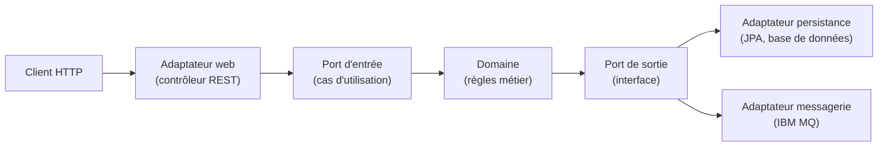
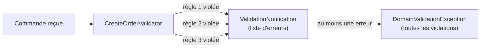
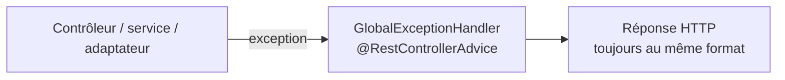
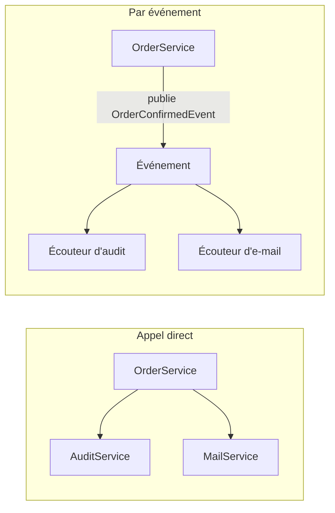
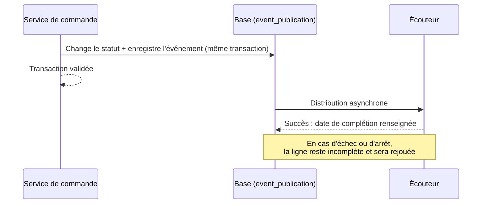

# Order Management : choix d'architecture du backend

> **Public visé** : toutes les équipes de développement, quel que soit leur niveau en Java.
> Chaque section commence par l'idée générale, puis détaille la mise en œuvre dans le projet.
> **Périmètre** : le backend uniquement (le frontend n'est pas couvert).

## Sommaire

1. [Vue d'ensemble](#1-vue-densemble)
2. [Structure des packages](#2-structure-des-packages)
3. [Validation dans le domaine](#3-validation-dans-le-domaine)
4. [Gestion des erreurs avec `@RestControllerAdvice`](#4-gestion-des-erreurs-avec-restcontrolleradvice)
5. [Spring Modulith](#5-spring-modulith)
6. [Glossaire](#6-glossaire)
7. [Où trouver le détail](#7-où-trouver-le-détail)

---

## 1. Vue d'ensemble

Order Management est une application Java (Spring Boot) qui gère des **commandes**, des
**clients** et des **produits**. Les quatre choix décrits dans ce document répondent chacun
à une question simple :

| Question | Choix | Section |
|---|---|---|
| Où ranger le code ? | Un package par **capacité métier**, avec une architecture hexagonale dans chacun | [2](#2-structure-des-packages) |
| Où vérifier les règles métier ? | Dans le **domaine**, en regroupant toutes les erreurs d'une requête | [3](#3-validation-dans-le-domaine) |
| Comment répondre en cas d'erreur ? | Un **format de réponse unique**, produit à un seul endroit | [4](#4-gestion-des-erreurs-avec-restcontrolleradvice) |
| Comment faire réagir une partie de l'application à une autre ? | Des **événements** Spring Modulith, durables | [5](#5-spring-modulith) |

### Le fil conducteur : l'architecture hexagonale

Tout le projet repose sur une règle : **le cœur métier ne dépend de rien de technique**.



- Le **domaine** contient les règles métier. Il ne connaît ni la base de données, ni HTTP, ni IBM MQ.
- Un **port** est une interface Java qui décrit un besoin. Un **adaptateur** est la classe qui le réalise avec une technologie précise.
- Les dépendances vont toujours **vers l'intérieur** : un adaptateur connaît le domaine, jamais l'inverse.

> **Pourquoi ?** On peut changer de base de données ou tester les règles métier sans démarrer
> Spring, parce que le domaine est du Java ordinaire.

Dans ce projet, les ports d'entrée retournent directement les objets du domaine
(style « pragmatique ») ; c'est le contrôleur qui les convertit en objets de réponse (DTO).

---

## 2. Structure des packages

### 2.1 Le choix : découper par métier, pas par couche technique

**Découpage par couche** (le plus courant, mais écarté) :

```
controller/   service/   repository/   model/
```

Chaque fonctionnalité est éparpillée dans quatre dossiers. Rien n'empêche une classe d'en
appeler n'importe quelle autre : le couplage grandit avec le temps.

**Découpage par capacité métier** (le choix retenu) : un package par sujet métier, avec ses
propres couches à l'intérieur.

```
com.example.ordermanagement
├── order/            commandes
├── customer/         clients
├── product/          produits
├── notification/     réactions aux événements (journal d'audit, e-mail simulé)
├── shared/           éléments communs (hiérarchie d'exceptions, validation)
└── infrastructure/   configuration transverse (sécurité, JMS, gestion des erreurs web)
```

### 2.2 Le contenu d'un module métier

Chaque module (`order`, `customer`, `product`) a la même forme :

```
order/
├── CreateOrderUseCase, GetOrderUseCase, ...     ← API publique (à la racine)
├── OrderConfirmedEvent, OrderCancelledEvent...  ← événements publiés (à la racine)
├── OrderNotFoundException                       ← exception publique (à la racine)
└── internal/                                    ← tout le reste est privé
    ├── domain/        Order, OrderItem, OrderStatus, OrderDomainService, CreateOrderValidator
    ├── port/out/      OrderRepositoryPort, OrderEventPort, OrderStatusEventPort
    └── adapter/
        ├── in/web/         OrderController et DTO de requête/réponse
        ├── out/persistence/  entités JPA, OrderPersistenceAdapter
        ├── out/messaging/    publication et écoute IBM MQ
        ├── out/batch/        traitement Spring Batch (CONFIRMED → COMPLETED)
        └── events/           publication des événements internes
```

### 2.3 Les règles à retenir

| Règle | Explication |
|---|---|
| **La racine du module est son API** | Les cas d'utilisation, les événements et les exceptions sont publics : un autre module peut les utiliser. |
| **`internal/` est privé** | Aucun autre module ne doit importer une classe de `internal/`. |
| **Les modules se parlent par leur API** | `order` a besoin d'un client ? Il passe par `GetCustomerUseCase`, jamais par le dépôt interne de `customer`. |
| **Un adaptateur de sortie n'appelle jamais un port d'entrée** | Sinon le flux de contrôle devient circulaire. |
| **Le domaine n'importe pas d'adaptateur** | Les dépendances pointent vers l'intérieur. |

### 2.4 Pourquoi ce choix ?

| Avantages | Inconvénients |
|---|---|
| Tout ce qui concerne « les commandes » est au même endroit | Plus de dossiers à créer pour un nouveau module |
| Les frontières entre sujets métier sont visibles et contrôlables | Les classes communes demandent un arbitrage (`shared`) |
| Un module bien isolé pourra, si besoin, devenir un service indépendant | La discipline « API à la racine, reste dans `internal` » doit être tenue par l'équipe |
| Spring Modulith peut analyser et documenter la structure (voir section 5) | |

> **Remarque sur Maven.** Les modules Maven (`domain`, `adapter-out-persistence`,
> `adapter-in-web`, …) sont conservés. Les packages d'un même module Modulith peuvent donc
> être répartis sur plusieurs fichiers jar. Cela limite le risque de la migration.

### 2.5 Où placer un nouveau code ?

| Je veux ajouter… | Je le place dans… |
|---|---|
| Un nouveau cas d'utilisation | La racine du module (interface), son implémentation dans `internal/domain/` |
| Une règle métier sur une entité | `internal/domain/`, comme méthode de l'entité |
| Un nouvel endpoint REST | `internal/adapter/in/web/` du module concerné |
| Une table ou une entité JPA | `internal/adapter/out/persistence/` + un script Liquibase |
| Un événement que d'autres modules écoutent | La racine du module émetteur |
| Une exception métier | La racine du module (ou `shared/` si elle est transverse) |

---

## 3. Validation dans le domaine

### 3.1 Le choix : les règles métier vivent dans le domaine

Il existe plusieurs niveaux de validation. Chacun a sa place :

| Niveau | Exemple | Où | Réponse |
|---|---|---|---|
| **Forme de la requête** | `quantity` manquant, e-mail mal formé | Bean Validation (`@NotNull`…) sur les DTO, dans le contrôleur | 400 |
| **Invariant d'une entité** | Une commande sans ligne, un prix négatif | Dans l'entité elle-même (`Order.create`, `Product.create`) | 400 / 409 |
| **Règle métier fonctionnelle** | Le produit n'existe pas, n'est pas commandable, le prix a changé | Dans un **validateur du domaine** | 422 |

> **Pourquoi dans le domaine ?** Une règle métier doit s'appliquer quel que soit l'appelant :
> API REST, traitement batch ou message MQ. Si elle vivait dans le contrôleur, il faudrait la
> recopier ailleurs.

### 3.2 Niveau 1 : les invariants de l'entité

L'entité refuse d'exister dans un état invalide. Elle jette une exception Java standard :

```java
public static Customer create(String firstName, String lastName, String telephone, String email) {
    // ...
    if (firstName == null || firstName.isBlank())
        throw new IllegalArgumentException("Customer first name must not be blank");
    // ...
}
```

- `IllegalArgumentException` : une valeur est invalide (réponse HTTP 400).
- `IllegalStateException` : une transition est interdite, par exemple confirmer une commande déjà confirmée (réponse HTTP 409).

Pas de classe d'exception sur mesure ici : l'entité reste du Java pur.

### 3.3 Niveau 2 : les validateurs du domaine (le « Notification pattern »)

**Problème.** Valider avec `throw` s'arrête à la première erreur. Un client qui envoie une
commande avec un client inconnu *et* deux produits invalides doit corriger, renvoyer, puis
découvrir l'erreur suivante, et ainsi de suite.

**Solution.** Un validateur ne jette jamais d'exception à la première règle violée. Il
**collecte** les violations dans une « notification », puis le service lève **une seule**
exception à la fin.



Les trois classes du mécanisme (dans le package `shared`) :

| Classe | Rôle |
|---|---|
| `DomainValidator<T>` | Interface : `validate(commande, notification)` |
| `ValidationNotification` | Boîte qui accumule des `DomainViolation` |
| `DomainViolation` | Une erreur : un **code** stable, un **chemin** (le champ concerné) et un **message** |

Exemple simplifié, tiré de `CreateOrderValidator` :

```java
public void validate(CreateOrderCommand command, ValidationNotification notification) {
    if (client inconnu) {
        notification.addError("CUSTOMER_NOT_FOUND", chemin, "Customer not found: ...");
    }
    for (chaque ligne de la commande) {
        if (produit inconnu)      notification.addError("PRODUCT_NOT_FOUND", ...);
        else if (non commandable) notification.addError("PRODUCT_NOT_AVAILABLE", ...);
        else if (prix différent)  notification.addError("PRICE_MISMATCH", ...);
    }
}
```

Le prix envoyé par le client n'est jamais considéré comme la vérité : il doit correspondre
au catalogue, ce qui détecte aussi bien un prix périmé qu'une tentative de fraude.

### 3.4 Quelle exception pour quelle situation ?

| Situation | Exception | Code HTTP |
|---|---|---|
| Valeur invalide dans une entité | `IllegalArgumentException` | 400 |
| Transition d'état interdite | `IllegalStateException` | 409 |
| Plusieurs règles métier violées | `DomainValidationException` (liste de violations) | 422 |
| Ressource introuvable | `ResourceNotFoundException` (sous-classes : `OrderNotFoundException`…) | 404 |
| Ressource déjà existante | `ResourceAlreadyExistsException` | 409 |

Ces exceptions ont une base commune, `DomainException`, ce qui permet à la gestion des
erreurs (section 4) de les traiter de façon uniforme.

### 3.5 Avantages et limites

| Avantages | Limites |
|---|---|
| Règles appliquées partout, quel que soit l'appelant | Un validateur qui interroge la base ajoute des lectures |
| Toutes les erreurs en une seule réponse | Les validateurs doivent rester sans effet de bord |
| Facile à tester sans Spring (simples classes Java) | La vérification « avant » ne remplace pas les contraintes de la base (voir ci-dessous) |

> **La base reste la source de vérité.** Une règle d'unicité (par exemple l'e-mail d'un
> client) est garantie par un index unique en base. Le validateur fait une vérification
> préalable pour répondre vite et clairement, mais deux requêtes simultanées peuvent passer
> la vérification : c'est l'index qui tranche, et l'erreur est alors traduite proprement (section 4).

---

## 4. Gestion des erreurs avec `@RestControllerAdvice`

### 4.1 Le problème

Une requête peut échouer à des endroits très différents : format JSON invalide, règle
métier, base de données indisponible, jeton absent… Chaque couche lève sa propre exception.
Sans organisation, l'API renverrait **des formats de réponse différents** selon l'endroit
où l'erreur survient, et chaque client devrait gérer tous ces cas.

### 4.2 Le choix : un seul format, produit à un seul endroit

**`@RestControllerAdvice`** est une annotation Spring qui désigne une classe appliquée à
*tous* les contrôleurs. Ses méthodes annotées `@ExceptionHandler` interceptent les
exceptions et construisent la réponse HTTP. Dans le projet, cette classe est
`GlobalExceptionHandler`.



Les contrôleurs et les services **ne construisent jamais** de réponse d'erreur : ils lèvent
une exception, et le gestionnaire s'en charge.

### 4.3 Le format de réponse unique

Toute erreur de l'API est un `ResponseApiError` contenant une ou plusieurs `ApiError` :

| Champ | Contenu | Exemple |
|---|---|---|
| `code` | Identifiant stable, utilisable par un programme | `PRODUCT_NOT_FOUND` |
| `level` | Gravité : `BLOCKING`, `FROCED` ou `INFORMATION` | `BLOCKING` |
| `label` | Titre lisible, fixe pour un code donné | `Product Not Found` |
| `description` | Détail propre à la requête | `Product with identifier '…' was not found.` |
| `uriDesc` | Lien vers la documentation du code | `https://…/PRODUCT_NOT_FOUND` |
| `errorsValueList` | Champs ou lignes concernés | `["<id produit>"]` |

- Les erreurs de même `code` sont **regroupées** : trois produits inconnus donnent une seule `ApiError` avec trois valeurs dans `errorsValueList`.
- `FROCED` désigne une erreur qui n'est pas la faute de l'appelant (technique) : son message est volontairement générique, sans détail interne.

### 4.4 Qui traduit quoi ?

`GlobalExceptionHandler` range ses méthodes en cinq familles :

| Famille | Exception | Code HTTP |
|---|---|---|
| **1. Métier** | `ResourceNotFoundException` | 404 |
| | `ResourceAlreadyExistsException` | 409 |
| | `DomainValidationException` | 422 |
| | `IllegalArgumentException` | 400 |
| | `IllegalStateException` | 409 |
| **2. Infrastructure** | `InfrastructureUnavailableException` (base ou broker indisponible) | 503 |
| | `OptimisticLockingConflictException` (modification concurrente) | 409 |
| | `PersistenceDataValidationException` (contrainte de données) | 409 |
| **3. Forme de la requête** | `MethodArgumentNotValidException` (Bean Validation) | 400 |
| | `HttpMessageNotReadableException` (JSON illisible) | 400 |
| | `MethodArgumentTypeMismatchException`, paramètre manquant | 400 |
| | `HttpRequestMethodNotSupportedException` | 405 |
| | `NoResourceFoundException` (URL inconnue) | 404 |
| **4. Sécurité** | `AccessDeniedException` (rôle insuffisant) | 403 |
| **5. Filet de sécurité** | `DomainException` non classée | 400 |
| | `Exception` (bug) | 500 |

**Ordre de précision.** Spring choisit le gestionnaire dont le type est le plus proche de
l'exception levée. `Exception` ne sert donc qu'en dernier recours.

### 4.5 Deux protections importantes

- **Pas de fuite d'information.** Pour une erreur inattendue (500), le client reçoit un message générique et une **référence** (un UUID) à communiquer au support. Le détail complet, y compris la pile d'appels, est écrit dans les journaux du serveur uniquement.
- **Traduction à la frontière technique.** Les adaptateurs (persistance, MQ) attrapent les exceptions techniques (`DataAccessException`, `JmsException`) et les convertissent en exceptions du domaine **sans y mettre de détail SQL ou broker**. Le domaine n'a donc jamais besoin de connaître JPA ou JMS.

### 4.6 Cas particulier : les erreurs de sécurité

Une requête sans jeton (401) ou refusée par le filtre de sécurité (403) est rejetée
**avant** d'arriver aux contrôleurs : `@RestControllerAdvice` ne la voit jamais. Deux classes
dédiées, `RestAuthenticationEntryPoint` et `RestAccessDeniedHandler`, produisent le **même
format** de réponse. Les refus de `@PreAuthorize`, eux, arrivent bien jusqu'au gestionnaire.

### 4.7 Ajouter une nouvelle erreur : mode d'emploi

1. Choisir ou créer l'exception, dérivée de `DomainException` (ou d'une de ses sous-classes).
2. Vérifier qu'un gestionnaire existant la couvre ; sinon ajouter une méthode `@ExceptionHandler` dans `GlobalExceptionHandler`.
3. Choisir le **code** (stable, en majuscules) et le **niveau** (`BLOCKING` si l'appelant peut corriger).
4. Ajouter un test qui vérifie le code HTTP et le `code` renvoyé.

### 4.8 Avantages et limites

| Avantages | Limites |
|---|---|
| Un client n'a qu'un format à comprendre | Tout nouveau type d'exception doit être branché dans le gestionnaire |
| Les contrôleurs restent simples (aucun `try/catch`) | Le gestionnaire est une classe volumineuse : sa structure en familles est essentielle |
| Aucune fuite de détail technique | Les erreurs de filtre de sécurité sont gérées ailleurs (section 4.6) |

---

## 5. Spring Modulith

### 5.1 L'idée

Une application peut être **découpée en parties qui réagissent les unes aux autres sans se
connaître**. Au lieu que le service de commande appelle directement l'audit, puis l'e-mail,
puis d'autres services, il **publie un fait** (« la commande a été confirmée ») et chaque
partie intéressée **réagit**.



| | Appel direct | Événement |
|---|---|---|
| Le service de commande connaît les autres | Oui | Non |
| Ajouter une réaction | Modifier le service de commande | Ajouter un écouteur |
| Une réaction qui échoue | Peut faire échouer la commande | N'affecte ni la commande ni les autres réactions |

### 5.2 Deux outils, deux usages

| Outil | Usage | Portée |
|---|---|---|
| **IBM MQ** | Prévenir **d'autres applications** | Entre processus distincts |
| **Spring Modulith** | Prévenir **d'autres parties de la même application** | Dans un seul processus, sans message externe |

Les deux se complètent : aucun ne remplace l'autre. Dans le projet, seule la partie
« événements » de Spring Modulith est utilisée, plus la génération de diagrammes.

### 5.3 Les événements

Les événements sont de simples `record` Java, placés à la racine du module `order` :

```java
public record OrderConfirmedEvent(UUID orderId, UUID customerId, LocalDateTime occurredAt) { }
```

Il en existe trois : `OrderConfirmedEvent`, `OrderCompletedEvent` et `OrderCancelledEvent`.
Ils ne contiennent que des **identifiants**, pas l'entité `Order` complète, pour ne pas
exposer le modèle interne aux autres modules.

**Pourquoi dans le module `order` ?** L'événement est un fait métier de ce module. Placé à
sa racine, il fait partie de son API publique : `notification` peut l'écouter sans toucher
à `internal/`. Comme il ne contient aucun import Spring, le domaine reste pur.

### 5.4 Publier : à travers un port

Le domaine ne publie pas lui-même avec Spring. Il appelle un **port de sortie** :

```java
public interface OrderStatusEventPort {
    void confirmed(Order order);
    void completed(Order order);
    void cancelled(Order order);
}
```

L'adaptateur `OrderStatusEventPublisher` transforme chaque appel en événement et le confie
à `ApplicationEventPublisher` de Spring. C'est l'architecture hexagonale appliquée aux
événements. Ce port est distinct de `OrderEventPort`, qui publie vers IBM MQ.

### 5.5 Écouter : `@ApplicationModuleListener`

```java
@ApplicationModuleListener
void on(OrderConfirmedEvent event) {
    log.info("Order {} confirmed at {}", event.orderId(), event.occurredAt());
}
```

Cette annotation combine trois comportements :

| Comportement | Effet |
|---|---|
| **Asynchrone** | L'écouteur s'exécute dans un autre thread : celui qui publie n'attend pas. |
| **Propre transaction** | L'écouteur a sa transaction, indépendante de celle de l'émetteur. |
| **Après validation** | L'écouteur ne démarre qu'une fois la transaction de l'émetteur validée : pas de réaction à une action annulée. |

Conséquence : une erreur dans un écouteur n'annule pas la commande. En contrepartie, la
réaction est **décalée dans le temps** (cohérence à terme).

Le projet a deux écouteurs, dans le module `notification` :

| Écouteur | Rôle |
|---|---|
| `OrderStatusAuditListener` | Écrit une ligne de journal par changement de statut |
| `CustomerNotificationListener` | Simule l'envoi d'un e-mail au client (un simple `log.info`) |

**Règle : un écouteur par effet de bord.** Ajouter une réaction revient à ajouter un
écouteur ; ni l'événement ni le code qui publie ne changent.

### 5.6 Durabilité : ne jamais perdre un événement

Avant de distribuer un événement, Modulith l'**enregistre en base** dans la table
`event_publication` (une ligne par écouteur concerné), dans la même transaction que le
changement de statut.



Configuration utilisée (`application.yml` de `adapter-in-web`) :

```yaml
spring:
  modulith:
    events:
      republish-outstanding-events-on-restart: true
```

Si l'application s'arrête après la validation mais avant le passage de l'écouteur,
l'événement est redistribué au prochain démarrage.

### 5.7 Attention : livraison « au moins une fois »

Un événement peut être livré **plus d'une fois** (relance au redémarrage, ou échec de
l'enregistrement de la complétion après un succès). Un écouteur doit donc être
**idempotent** : le rejouer ne doit pas produire un second effet.

| Écouteur | Rejouable sans risque ? |
|---|---|
| Journal d'audit | Oui : au pire une ligne en double |
| E-mail **simulé** | Oui : au pire une ligne de journal en double |
| E-mail **réel** (à venir) | **Non** : il faudra mémoriser qu'une notification a déjà été envoyée pour cet événement |

Autre règle : si le client est introuvable, l'écouteur journalise un avertissement et
s'arrête **sans lever d'exception**. Sinon la relance échouerait indéfiniment sur un
problème qu'elle ne peut pas corriger.

### 5.8 Faire une transition d'état dans un écouteur : avec discernement

Un écouteur peut déclencher la transition suivante d'une commande (schéma de chorégraphie).
Ce n'est **pas** implémenté dans le projet, et à utiliser avec précaution.

| Pertinent | Pièges |
|---|---|
| Réaction à un fait métier (paiement confirmé, donc commande payée) | Le déroulement est dispersé entre plusieurs écouteurs : plus dur à suivre |
| Processus en plusieurs étapes ou entre plusieurs modules | Chaque étape a sa transaction : il faut prévoir un état d'échec |
| Étape lente ou pouvant échouer, rejouable | La transition doit être idempotente ; attention aux boucles d'événements |

Dans ce projet, les transitions actuelles restent dans `OrderDomainService` : elles sont
immédiates et doivent être cohérentes tout de suite.

### 5.9 Documenter les modules : les diagrammes

Spring Modulith **analyse le code** et génère des diagrammes à jour. Règle de détection :
chaque sous-package direct de `com.example.ordermanagement` est un module.

Le test `ModulithDocumentationTest` (dans `adapter-in-web`) produit, dans
`adapter-in-web/target/spring-modulith-docs` :

| Fichier | Contenu |
|---|---|
| `components.puml` | Vue d'ensemble de tous les modules et de leurs liens (diagramme C4) |
| `module-<nom>.puml` | Un diagramme par module |
| `module-<nom>.adoc` | Fiche du module : composants, références de beans, événements écoutés |

Pour le générer : `mvn test -pl adapter-in-web -am -Dtest=ModulithDocumentationTest`.
Les fichiers `.puml` se visualisent avec PlantUML ou un greffon d'IDE, les `.adoc` avec
n'importe quel outil AsciiDoc.

Liens actuellement détectés :

| Module | Relation | Module |
|---|---|---|
| `order` | utilise | `customer`, `product` |
| `notification` | écoute | `order` |
| `notification` | utilise | `customer` |
| `order`, `customer`, `product`, `infrastructure` | dépendent de | `shared` |

### 5.10 État de la migration

| Point | État |
|---|---|
| Packages réorganisés par module | Fait |
| Documentation et diagrammes générés | Fait |
| `CreateOrderValidator`, `OrderDomainService` et `CustomerNotificationListener` utilisent encore les ports internes de `customer` et `product` | **À faire** : passer par `GetCustomerUseCase` et `GetProductUseCase` |
| `ApplicationModules.verify()` (contrôle automatique des frontières) | Non activé, il signalerait ces accès |
| Tests d'intégration sur la nouvelle structure | Non relancés (PostgreSQL et IBM MQ requis) |
| Table `event_publication` : script reconstitué à la main | À comparer à la documentation officielle de la version 2.1.1 |

---

## 6. Glossaire

| Terme | Définition |
|---|---|
| **Agrégat** | Objet métier qui protège ses propres règles (`Order`, `Customer`, `Product`) |
| **Adaptateur** | Classe qui réalise un port avec une technologie précise (JPA, MQ, REST) |
| **Port** | Interface Java décrivant un besoin du domaine (sortie) ou un cas d'utilisation (entrée) |
| **Cas d'utilisation (use case)** | Une action métier exposée par le domaine (`CreateOrderUseCase`) |
| **DTO** | Objet de transfert pour l'API (requête, réponse), distinct de l'objet métier |
| **Domaine** | Cœur métier, sans dépendance technique |
| **Événement** | Fait métier passé (« la commande a été confirmée ») publié pour que d'autres réagissent |
| **Idempotent** | Qui peut être exécuté plusieurs fois avec le même résultat que s'il l'était une seule fois |
| **Module (Modulith)** | Sous-package direct du package racine, avec une API publique et un intérieur privé |
| **Notification pattern** | Collecter toutes les erreurs de validation avant de répondre, au lieu de s'arrêter à la première |
| **`@RestControllerAdvice`** | Classe Spring qui traite les exceptions de tous les contrôleurs |
| **Cohérence à terme** | Un état secondaire (e-mail, audit) est mis à jour un peu plus tard, pas dans la même transaction |

---

## 7. Où trouver le détail

| Sujet | Document du dépôt |
|---|---|
| Règles d'architecture et conventions | `CLAUDE.md` |
| Validation et gestion des erreurs, en détail | `Validation.md` |
| Choix sur les événements, le client et l'e-mail simulé | `Events_CoiseII.md` |
| Stratégie de tests d'intégration et infrastructure | `INTEGRATION_TESTS.md` |
